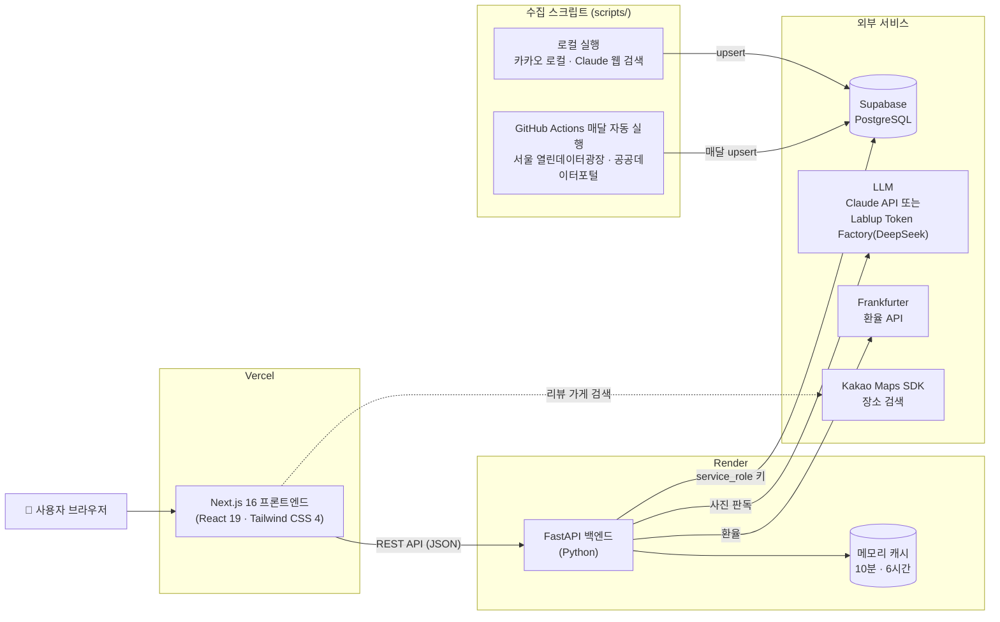
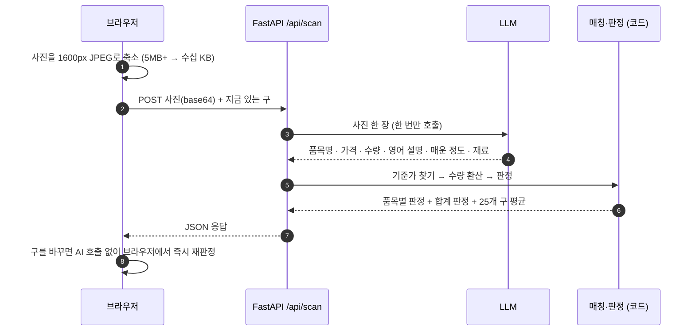
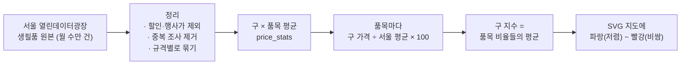

# 비싼감? · WonSense

> **"이 가격, 서울에선 비싼 걸까?"**
> 외국인이 가격표·메뉴판 사진 한 장으로 서울 물가를 바로 판단할 수 있게 돕는 서비스

| 🌐 배포 | 🎬 시연 영상 |
| :---: | :---: |
| **[won-sense-seven.vercel.app](https://won-sense-seven.vercel.app)** | **[youtu.be/DbW0YEleRmY](https://youtu.be/DbW0YEleRmY)** |

---

## 목차

1. [왜 만들었나요?](#1-왜-만들었나요)
2. [주요 기능](#2-주요-기능)
3. [시스템 구조](#3-시스템-구조)
4. [기술 스택](#4-기술-스택)
5. [기술별 동작 원리](#5-기술별-동작-원리)
6. [데이터 출처](#6-데이터-출처)
7. [프로젝트 구조](#7-프로젝트-구조)
8. [로컬에서 실행하기](#8-로컬에서-실행하기)
9. [테스트와 배포](#9-테스트와-배포)

---

## 1. 왜 만들었나요?

서울을 찾은 외국인은 **가격표를 읽을 수 없고**, 읽더라도 **그 가격이 적당한지 비교할 기준이 없습니다.**
그래서 바가지를 써도 알아채기 어렵고, 반대로 정상 가격도 의심하게 됩니다.

**비싼감?** 은 공공데이터(서울시 생필품 가격, 착한가격업소 메뉴 등)를 기준으로 삼고,
AI가 사진 속 한국어 가격표를 읽어 **"서울 평균보다 몇 % 비싼지"** 를 숫자로 알려 줍니다.

---

## 2. 주요 기능

| 기능 | 무엇을 하나요? | 주소 |
| --- | --- | --- |
| 📸 **바가지 판독기** | 가격표·메뉴판·영수증을 찍으면 품목마다 **저렴 / 적정 / 조금 비쌈 / 바가지** 를 판정합니다. 메뉴는 **영어 설명·매운 정도·알레르기 재료·채식 여부** 까지 알려 줍니다. 지금 있는 구를 고르면 **그 동네 평균** 으로 다시 판정합니다. | `/scan` |
| 🔎 **물가 검색** | `soju`, `bibimbap`, `김치찌개`처럼 영어·한국어로 검색하면 장보기·식당·편의점 가격을 한 번에 보여 줍니다. 오타도 "혹시 이걸 찾으셨나요?"로 바로잡습니다. | `/search` |
| 🧠 **물가 퀴즈 · 가격 감 익히기** | 가격 맞히기, 더 비쌀까?, 이 가격 괜찮을까? 퀴즈와 "이 돈으로 뭘 살 수 있을까" 금액 퀴즈, 가격 순서 맞히기(가격 사다리)로 서울 물가 감을 익힙니다. | `/quiz` |
| 🗺️ **서울 물가 히트맵** | 25개 자치구의 장보기 물가를 서울 평균(100)과 비교한 지수로 지도에 칠합니다. 구를 누르면 품목별로 더 비싼·싼 품목을 보여 줍니다. | `/heatmap` |
| 💱 **오늘의 환율** | 22개 통화의 원화 환율, 전일 대비 변화, 14일 추이 그래프, 환율 계산기를 제공합니다. 홈 화면 카드에 보일 통화 4개를 직접 고를 수 있습니다. | `/fx` |
| ⭐ **외국인 찐 리뷰** | 로그인 없이 "어디서 무엇을 얼마에 샀는지" 리뷰를 남깁니다. 가게는 카카오 장소 검색으로 고릅니다. | `/reviews` |
| 🌏 **한국어 / English** | 모든 화면을 오른쪽 위 버튼 하나로 전환합니다. 처음 방문하면 브라우저 언어에 맞춰 시작합니다. | 전체 |

---

## 3. 시스템 구조



- **브라우저는 DB에 직접 접근하지 않습니다.** 모든 데이터는 FastAPI를 거칩니다 (아래 [보안](#59-보안) 참고).
- **가격 데이터는 API 서버가 아니라 수집 스크립트가 넣습니다.** 공공데이터는 GitHub Actions가 매달 자동으로 수집하고, 서버는 읽기만 합니다.

---

## 4. 기술 스택

| 영역 | 기술 | 쓰는 곳 |
| --- | --- | --- |
| **프론트엔드** | Next.js 16 (App Router, Cache Components) · React 19 · TypeScript · Tailwind CSS 4 | 모든 화면, Vercel 배포 |
| **백엔드** | FastAPI · Pydantic Settings · Uvicorn | REST API, Render 배포 |
| **데이터베이스** | Supabase (PostgreSQL, RLS) · supabase-py | 가격 통계, 메뉴, 리뷰 |
| **AI** | Anthropic SDK · Claude Haiku 5.5 (비전 + 구조화 출력) · DeepSeek-V4.1-Flash (Lablup Token Factory, Anthropic 호환 API) · Claude Opus 5.5 웹 검색 | 바가지 판독기, 식당 가격 수집 |
| **지도·장소** | 서울 자치구 경계 SVG (KOSTAT 경계 → 미리 변환) · Kakao Maps JavaScript SDK | 히트맵, 리뷰 가게 검색 |
| **보안** | bcrypt · Row Level Security · 비밀번호 시도 제한 | 리뷰 게시판 |
| **자동화** | GitHub Actions | 공공데이터 가격 매달 자동 수집 |
| **테스트** | pytest (89개) · ESLint · TypeScript | 백엔드 로직, 프론트 빌드 |

---

## 5. 기술별 동작 원리

### 5.1 바가지 판독기: 사진 → 판정

> **핵심 원칙: AI는 "읽기"만, 판정은 "코드"가 한다.**
> 가격 비교·퍼센트 계산을 AI에게 맡기지 않으므로, AI가 숫자를 지어낼 수 없습니다.



**① 기준가 찾기: 위에서부터 먼저 맞는 것을 씁니다**

| 순서 | 기준 | 비교 방법 |
| :---: | --- | --- |
| 1 | **서울시 생필품 가격** (공식, 114개 품목 × 25개 구) | 고른 구의 평균, 없으면 서울 평균 |
| 2 | **서울시 착한가격업소 메뉴 가격** (4,161개 메뉴) | 가게별 가격의 "보통 범위" **위쪽 끝(75번째 백분위)** · 착한가격업소는 일부러 싸게 받는 가게라 중앙값과 비교하면 일반 식당이 다 비싸게 나오기 때문 |
| 3 | **Numbeo 서울 생활물가** (카페·교통·의류 등 40개 항목) | 추정치로 표시 |

**② 수량 환산**: 규격이 달라도 비교할 수 있게 단위를 맞춥니다.
`계란 30구` vs 기준 `계란 10개` → **×3** · `콜라 1.5L` vs 기준 `0.33L` → **×4.5** · `1kg` ↔ `500g` → **×2**

**③ 판정 기준**

| 기준가 대비 | 판정 |
| --- | --- |
| 10% 넘게 저렴 | 🔵 저렴해요 |
| ±10% 이내 | 🟢 적정가예요 |
| 10~30% 비쌈 | 🟠 조금 비싸요 |
| 30% 넘게 비쌈 | 🔴 바가지 주의! |

**④ 두 가지 AI 경로**: 환경변수 하나로 바꿉니다 (`LLM_BASE_URL`, `LLM_MODEL`).

| | Claude (Haiku 5.5) | Anthropic 호환 게이트웨이 (DeepSeek-V4.1-Flash) |
| --- | --- | --- |
| AI가 하는 일 | 읽기 + 품목 대조 + 수량 비율 | **읽기 · 번역만** |
| 품목 대조 | 프롬프트에 품목 목록 포함 (프롬프트 캐시) | 코드가 대조 (`scan_match.py`) |
| 응답 형식 | 구조화 출력 (`messages.parse`)으로 스키마 보장 | JSON 답변을 Pydantic으로 검증 |
| 출력 받기 | 일반 호출 | **스트리밍** · 출력 한도 16,000토큰 |

> **왜 나눴나요?** DeepSeek에 "읽기 + 125개 대조 + 비율 계산"을 한 번에 시키면 생각(thinking)이 길어져 출력 한도를 다 쓰고 답을 못 냈습니다.
> AI에게는 읽기만 맡기고 대조를 코드로 옮겨 **응답 시간 약 1분 → 2~14초**, 실패율을 크게 줄였습니다 (실측).

**⑤ 메뉴판 통역**: 같은 호출에서 메뉴마다 `description_en`(한 줄 설명), `spice_level`(0~3), `contains`(돼지고기·해산물·견과류 등 10가지 중), `vegetarian`을 받아 칩으로 보여 줍니다. 알레르기 정보는 AI 추정이라는 안내를 함께 표시합니다.

---

### 5.2 물가 검색: 영어·한국어 한 번에

검색어 하나로 **네 가지 데이터** 를 동시에 찾아 한 화면에 보여 줍니다.

| 결과 | 데이터 | 가격 표시 |
| --- | --- | --- |
| 장보기 품목 | 서울시 생필품 가격 | 25개 구 평균 중 최저 ~ 최고, 서울 평균 |
| 식당 메뉴 | 착한가격업소 | 가게별 가격의 가운데 50% ("보통"), 중앙값 |
| 마트·편의점 상품 | 한국소비자원 참가격 | 판매점별 정상가의 가운데 50%, 중앙값 |
| 일반 식당 | Claude 웹 검색으로 수집 | 지역별 중앙값 + **가격마다 출처 링크** |

**검색이 똑똑해지는 방법**
- **사전 매칭**: 원본 데이터는 한글뿐(`쌀(오대쌀) 10kg 1포`)이라, 기본 품목명마다 영어 이름과 동의어를 붙인 사전을 코드에 둡니다 (`ramyeon`·`ramen`·`라면` → 라면). DB를 건드리지 않아 다시 수집해도 그대로 동작합니다.
- **상품 패턴**: `toothpaste`처럼 종류로 찾으면, 종류마다 상품명 정규식(포함/제외)으로 `페리오`, `2080` 같은 브랜드 상품을 찾아냅니다.
- **오타 교정**: `bananna` → `banana`(difflib), `맥쥬` → `맥주`(한글을 자모로 분해해 비교).
- **"보통" 범위**: 극단값에 흔들리지 않도록 평균 대신 **25~75번째 백분위** 와 중앙값을 씁니다.

---

### 5.3 서울 물가 히트맵



- **지수 계산**: 품목마다 구 가격을 서울 평균 대비 비율로 바꾼 뒤 평균을 냅니다. **100 = 서울 평균**, 높을수록 비쌉니다. 가격 수준이 다른 품목(쌀 vs 계란)도 공평하게 섞입니다.
- **색 단계**: 전체 지수는 구 차이가 작아서 ±1 / 2.5 / 5%, 품목 하나는 차이가 커서 ±2 / 5 / 10% 경계를 씁니다.
- **지도**: 통계청 행정구역 경계를 미리 SVG path로 변환해 코드에 넣어, 지도 라이브러리 없이 빠르게 그립니다. 영어 모드에서는 `Mapo`, `Gangnam`처럼 표시합니다.
- **캐시**: 한 기준일의 통계 전체를 한 번 읽어 메모리에 두고, 지도·품목 목록·구 상세 세 API가 나눠 씁니다.

---

### 5.4 물가 퀴즈 · 가격 감 익히기

**LLM 없이 DB 값만으로 문제를 만듭니다.** 그래서 빠르고, 비용이 없고, 틀린 정보가 나오지 않습니다.

| 퀴즈 | 만드는 방법 |
| --- | --- |
| 가격 맞히기 | 114개 품목의 문제·팁을 한국어·영어로 미리 DB에 저장. 오차 10% 이내 정답, 25% 이내 "아깝다" |
| 더 비쌀까? | 두 품목의 가격 차이가 **15% 이상** 인 쌍만 골라 찍기로 맞히기 어렵게 함 |
| 이 가격 괜찮을까? | 반반 확률로 "보통 범위 안" 또는 "보통보다 20~60% 비싼" 가격을 보여 줌 |
| 금액 퀴즈 · 가격 사다리 | 가격 카드를 **한 번만 받아** 브라우저에서 문제를 계속 만듦 (추가 API 호출 없음) |

- 로그인이 없어서 정답을 함께 보내고 **채점은 브라우저에서** 합니다.
- 직전에 나온 품목은 다시 나오지 않게 피합니다.

---

### 5.5 오늘의 환율

- **Frankfurter API**(중앙은행 기준 환율, 키 불필요)에서 원화 기준 22개 통화를 받습니다. 엔화·동·루피아처럼 단위가 작은 통화는 관례대로 100 단위로 보여 줍니다.
- **6시간 캐시**: 환율은 하루 한 번 바뀌므로 외부 호출을 최소화합니다.
- **장애 대비**: 외부 API가 실패하면 마지막으로 받은 값을 계속 보여 주고, 5분 뒤에 다시 시도합니다.
- 홈 카드에 보일 통화 4개는 브라우저(localStorage)에 저장됩니다.

---

### 5.6 외국인 찐 리뷰

| 장치 | 동작 |
| --- | --- |
| **로그인 없는 글 관리** | 글마다 비밀번호를 받아 **bcrypt 해시** 로만 저장하고, 응답에는 절대 포함하지 않습니다. bcrypt 한도(72바이트)에 맞춰 한글 비밀번호 길이도 검사합니다. |
| **무차별 대입 방지** | 같은 사용자가 같은 글에 비밀번호를 **10분에 5번** 틀리면 잠깁니다. |
| **검색어 안전 처리** | DB 필터 문법에 쓰이는 문자(`,` `.` `(` `)` `*` `%` 등)를 지워 검색어로 필터를 조작할 수 없게 합니다. |
| **가게 고르기** | Kakao Maps JavaScript SDK로 장소를 검색하면 가게 이름·종류·자치구가 자동으로 채워집니다. |

---

### 5.7 한국어 / English 전환

- 모든 문구는 `strings.ts`에 `ko`·`en` 두 벌로 있고, **TypeScript 타입이 두 벌의 키가 같은지 검사** 합니다. 영어 문구가 하나라도 빠지면 빌드가 실패합니다.
- 선택한 언어는 **localStorage** 에 저장하고 `useSyncExternalStore`로 읽어, 버튼을 누르면 새로고침 없이 바로 바뀝니다.
- **왜 쿠키가 아닌가요?** Next.js Cache Components 환경에서 서버가 쿠키를 읽으면 모든 페이지가 미리 렌더링(정적 생성)에서 빠집니다. 브라우저 저장소를 써서 **모든 페이지를 정적 페이지로 유지** 했습니다.
- 자치구 이름(`마포구` → `Mapo-gu`), 날짜 형식, 퀴즈 문제, 오류 메시지까지 함께 바뀝니다.

---

### 5.8 데이터 수집 파이프라인

API 서버가 아니라 **수집 스크립트** 가 Supabase에 넣습니다. 모두 `upsert`라 다시 돌려도 중복되지 않습니다.
공공데이터 3종은 **GitHub Actions**(`.github/workflows/ingest.yml`)가 **매달 3일 03:00 KST** 에 자동으로 수집합니다. Actions 탭의 "Run workflow"로 원하는 달을 지정해 수동 실행할 수도 있고, 스크립트 하나가 실패해도 나머지는 계속 돕니다.

| 스크립트 | 출처 | 저장 테이블 | 실행 | 하는 일 |
| --- | --- | --- | --- | --- |
| `ingest_prices.py` | 서울 열린데이터광장 생필품 가격 | `items`, `price_stats` | ⏰ 매달 자동 | 월 단위로 받아 구·품목별 최저/평균/최고 집계 |
| `ingest_menus.py` | 서울시 착한가격업소 상품목록 | `menu_prices` | ⏰ 매달 자동 | 주소에서 자치구를 뽑아 저장, 폐업·삭제된 메뉴 정리 |
| `ingest_products.py` | 공공데이터포털 한국소비자원 참가격 | `product_prices` | ⏰ 매달 자동 | 상품별 정상가 분포를 요약 (편의점 가격은 따로) |
| `mine_restaurant_prices.py` | 카카오 로컬 + **Claude 웹 검색** | `restaurant_prices` | 🖐 로컬 | 아래 참고 (검색 비용이 들어 사람이 실행) |
| `check_llm.py` | — | — | 🖐 로컬 | 지금 설정한 LLM으로 실제 호출·사진 판독이 되는지 점검 |

**AI 웹 검색으로 일반 식당 가격을 모을 때, 지어낸 가격을 막는 규칙**
1. 카카오 로컬 API로 명동·홍대·강남역·이태원·안암의 식당 목록을 가져옵니다.
2. Claude Opus 5.5가 웹 검색으로 그 식당의 메뉴 가격을 찾습니다 (식당당 검색 최대 5번으로 비용 제한).
3. 답한 **출처 URL이 그 호출에서 웹 검색이 실제로 돌려준 URL 중 하나가 아니면 버립니다.**
4. 3,000~100,000원 밖의 가격은 버리고, 저장된 행은 `verified = false`로 두어 사람이 확인한 뒤 바꿉니다.

---

### 5.9 보안

- **DB 직접 접근 차단**: 모든 테이블에 Row Level Security를 켜고 정책을 두지 않아, 브라우저용 `anon` 키로는 아무것도 읽을 수 없습니다.
- **비밀 키는 서버에만**: `service_role` 키와 LLM 키는 백엔드 환경변수에만 두고 깃에 올리지 않습니다.
- **CORS**: 배포 주소와 Vercel 미리보기 주소(`won-sense*.vercel.app`)만 정규식으로 허용합니다.

---

### 5.10 성능과 안정성

| 문제 | 해결 |
| --- | --- |
| Render 무료 플랜은 15분 쉬면 잠들고 깨는 데 30초~1분 | 어느 페이지든 열리면 `/health`를 미리 호출해 서버를 깨움 (`BackendWarmUp`) |
| 서버가 깬 뒤 첫 요청이 DB 로딩(약 6초)을 기다림 | 서버 시작 시 품목·메뉴 데이터를 백그라운드로 미리 불러옴 |
| 같은 가격 데이터를 요청마다 DB에서 읽음 | 가격은 월 1회 바뀌므로 **10분 메모리 캐시** (`TtlCache`) |
| 동시 요청에서 Supabase HTTP/2 연결 공유 시 `ReadError` | 스레드마다 Supabase 클라이언트를 따로 둠 |
| PostgREST는 한 번에 1,000행까지만 줌 | 유일 컬럼까지 정렬해 끝까지 나눠 받기 (`fetch_all`) |
| 폰 사진이 5MB 넘음 | 업로드 전에 브라우저에서 1600px JPEG로 축소 |
| LLM 실패 시 사용자가 몇 분씩 대기 | 재시도 1번, 타임아웃 90초로 빠르게 실패를 알림 |

---

## 6. 데이터 출처

| 데이터 | 제공 | 쓰는 곳 |
| --- | --- | --- |
| 생필품 농수축산물 가격 (전통시장·대형마트, 구별) | [서울 열린데이터광장](https://data.seoul.go.kr) | 히트맵, 검색, 퀴즈, 판독기 |
| 가격안정 모범업소(착한가격업소) 상품목록 | 서울 열린데이터광장 | 검색, 퀴즈, 판독기 |
| 생필품 가격 정보 (참가격) | [공공데이터포털](https://www.data.go.kr) · 한국소비자원 | 검색 |
| 서울 생활물가 | [Numbeo](https://www.numbeo.com/cost-of-living/in/Seoul) | 판독기 (추정치) |
| 환율 | [Frankfurter](https://frankfurter.dev) | 환율 |
| 장소 검색 | [Kakao Developers](https://developers.kakao.com) | 리뷰, 식당 가격 수집 |
| 서울 행정구역 경계 | 통계청 (KOSTAT) · [southkorea/seoul-maps](https://github.com/southkorea/seoul-maps) | 히트맵 지도 |

---

## 7. 프로젝트 구조

```text
WonSense/
├── frontend/                  # Next.js 16 (Vercel)
│   └── src/
│       ├── app/               # 페이지: /, /scan, /search, /quiz, /heatmap, /fx, /reviews
│       ├── components/        # 기능별 UI: scan, search, quiz, learn, heatmap, fx, reviews
│       └── lib/               # API 호출, 다국어(i18n·strings), 판정 재계산, 카카오 SDK
├── backend/                   # FastAPI (Render)
│   ├── app/
│   │   ├── main.py            # 앱 생성, CORS, 시작 시 데이터 미리 불러오기
│   │   ├── core/              # 설정, 메모리 캐시, LLM 클라이언트
│   │   ├── db/                # Supabase 클라이언트, 전체 행 읽기
│   │   ├── routers/           # API: scan, items(검색), heatmap, quiz, fx, reviews, stores, health
│   │   ├── services/          # 계산·매칭 로직 (DB를 직접 읽지 않아 테스트하기 쉬움)
│   │   └── data/              # Numbeo 서울 생활물가
│   ├── scripts/               # 가격 수집 스크립트
│   └── tests/                 # pytest
├── .github/workflows/         # ingest.yml: 공공데이터 가격 매달 자동 수집
├── supabase/migrations/       # DB 스키마 (테이블 설계: docs/DB_DESIGN.md)
├── docs/                      # MVP 기획서, 디자인 가이드, DB 설계
├── mascot/                    # 호랑이 마스코트 이미지
└── render.yaml                # 백엔드 배포 설정 (Render Blueprint)
```

**API 한눈에 보기** (실행 후 `http://localhost:8000/docs`에서 전체 문서 확인)

| 메서드 | 경로 | 설명 |
| --- | --- | --- |
| `POST` | `/api/scan` | 사진 판독 + 가격 판정 |
| `GET` | `/api/items/search?q=` | 물가 검색 (장보기·식당·상품·일반 식당) |
| `GET` | `/api/heatmap` · `/api/heatmap/items` · `/api/heatmap/districts/{구 코드}` | 히트맵 지수, 품목 목록, 구 상세 |
| `GET` | `/api/quiz/random` · `/api/quiz/prices` | 퀴즈 한 문제, 가격 감 익히기 카드 |
| `GET` | `/api/fx` | 환율 (`?all=true`면 22개 통화) |
| `GET` `POST` `PATCH` `DELETE` | `/api/reviews` | 리뷰 목록·작성·수정·삭제 (비밀번호 확인) |
| `GET` `POST` | `/api/stores` | 가게 검색·등록 |
| `GET` | `/health` · `/health/db` | 서버·DB 연결 확인 |

---

## 8. 로컬에서 실행하기

**백엔드** (Python 3.12 이상)

```bash
cd backend
python -m venv .venv
source .venv/bin/activate          # Windows: .venv\Scripts\activate
pip install -r requirements.txt
cp .env.example .env               # 아래 환경변수 입력
uvicorn app.main:app --reload      # http://localhost:8000/docs
```

**프론트엔드** (Node.js 20 이상)

```bash
cd frontend
npm install
cp .env.example .env.local         # NEXT_PUBLIC_API_URL=http://localhost:8000
npm run dev                        # http://localhost:3000
```

<details>
<summary><b>환경변수 목록</b></summary>

| 변수 | 위치 | 설명 |
| --- | --- | --- |
| `SUPABASE_URL`, `SUPABASE_SERVICE_ROLE_KEY` | backend | Supabase 프로젝트 주소와 서버 전용 키 (필수) |
| `ANTHROPIC_API_KEY` | backend | Claude로 사진 판독 |
| `LLM_BASE_URL`, `LLM_API_KEY`, `LLM_MODEL` | backend | Claude 대신 Anthropic 호환 게이트웨이(예: Lablup Token Factory의 DeepSeek) 사용 |
| `SEOUL_OPENAPI_KEY` | backend | 서울 열린데이터광장 (수집 스크립트) |
| `DATA_GO_KR_API_KEY` | backend | 공공데이터포털 참가격 (수집 스크립트) |
| `KAKAO_REST_API_KEY` | backend | 카카오 로컬 (식당 가격 수집 스크립트) |
| `CORS_ORIGINS` | backend | 허용할 프론트 주소 (쉼표로 여러 개) |
| `NEXT_PUBLIC_API_URL` | frontend | 백엔드 주소 (빌드 시 코드에 들어가므로 바꾸면 재배포) |
| `NEXT_PUBLIC_KAKAO_JS_KEY` | frontend | 리뷰 가게 검색 (없으면 직접 입력) |

</details>

**DB 스키마 적용**

```bash
supabase link --project-ref <project-ref>
supabase db push
```

**가격 데이터 수집** (`backend/`에서 직접 돌릴 때. 평소에는 GitHub Actions가 매달 자동 실행)

```bash
python -m scripts.ingest_prices --month 2026-10   # 생필품 가격 (월 단위)
python -m scripts.ingest_menus                    # 착한가격업소 메뉴
python -m scripts.ingest_products                 # 참가격 상품
python -m scripts.check_llm menu.jpg              # LLM 연결·사진 판독 점검
```

---

## 9. 테스트와 배포

**테스트**

```bash
cd backend && pytest                              # 89개: 판정·매칭·수량 환산·검색·히트맵·퀴즈·리뷰·환율
cd frontend && npm run lint && npx tsc --noEmit && npm run build
```

**배포**

| 대상 | 플랫폼 | 방법 |
| --- | --- | --- |
| 프론트엔드 | **Vercel** | `main`에 머지하면 자동 배포. `NEXT_PUBLIC_API_URL`에 백엔드 주소 설정 |
| 백엔드 | **Render** (싱가포르, 무료 플랜) | `render.yaml` Blueprint, `main` 커밋 시 자동 배포 |
| 데이터베이스 | **Supabase** | `supabase db push`로 마이그레이션 반영 |
| 가격 데이터 | **GitHub Actions** | 매달 3일 03:00 KST 자동 수집 (저장소 Secrets에 Supabase·공공데이터 키 필요) |

---

## 문서

- [MVP 기획서](docs/MVP_SPEC.md) · [디자인 가이드](docs/DESIGN.md) · [DB 설계](docs/DB_DESIGN.md)
- [백엔드 상세](backend/README.md) · [프론트엔드 상세](frontend/README.md)

## 라이선스

[Apache License 2.0](LICENSE) · Copyright 2026. **8thSense** All Rights Reserved.
