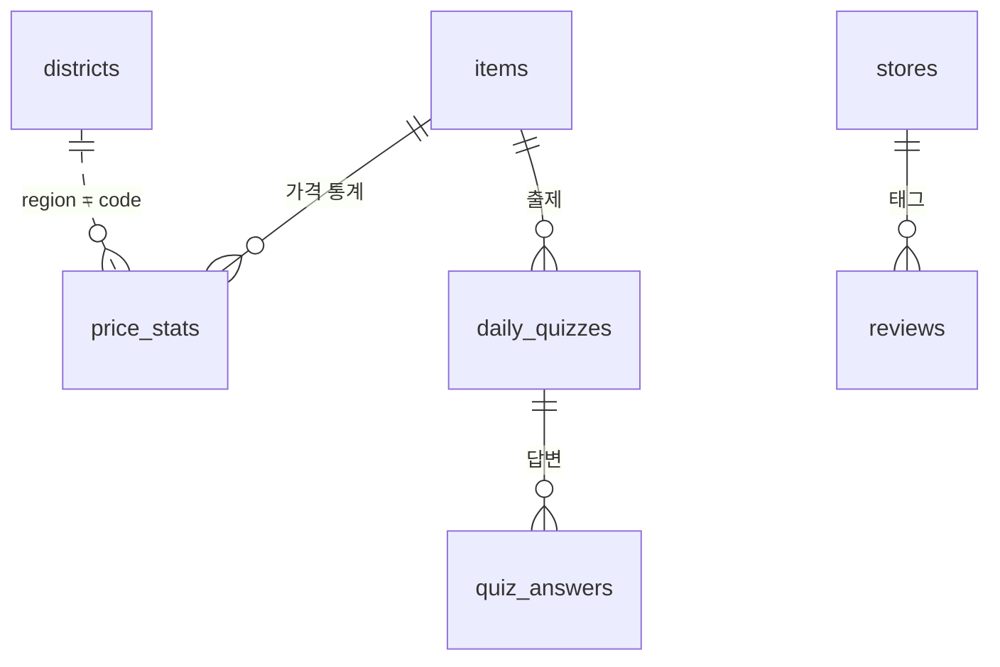

# WonSense DB 설계

> Supabase (PostgreSQL). 스키마 원본은 `supabase/migrations/`

| 마이그레이션 | 내용 |
| --- | --- |
| `20261031162626_init_schema.sql` | 품목·가격 통계·퀴즈·가게·리뷰 (F1, F2, F4) |
| `20261031164254_seoul_market_prices.sql` | 자치구(`districts`) + 원본 가격 테이블 (원본 테이블은 아래에서 삭제) |
| `20261101000000_heatmap_price_stats.sql` | 히트맵용 `items`·`price_stats` 확장 |
| `20261101000100_drop_market_raw_tables.sql` | 쓰지 않는 원본 가격 테이블·뷰 삭제 |
| `20261101000200_items_source_key_unique.sql` | `items.source_key` 유니크 제약 (수집 upsert용) |
| `20261101000300` ~ `000500` | 퀴즈 품목 지정, `quiz_texts` 캐시 (이후 000700에서 삭제) |
| `20261101000600_menu_prices.sql` | 식당 메뉴 가격 (착한가격업소) |
| `20261101000700_quiz_manual.sql` | 114개 전 품목의 퀴즈 문제·팁을 미리 저장, `quiz_texts` 삭제 |
| `20261101000800_product_prices.sql` | 마트·편의점 공산품 가격 요약 (참가격) |
| `20261101000900_quiz_english.sql` | 퀴즈 품목 영어 이름·팁 |
| `20261101001000_restaurant_prices.sql` | 일반 식당 메뉴 가격 (LLM 웹 검색) |

---

## 1. 전체 구조



| 기능 | 테이블 |
| --- | --- |
| F1 물가 검색 | `items`, `price_stats`, `menu_prices`, `product_prices`, `restaurant_prices` |
| F2 물가 퀴즈 | `items`, `price_stats`, `menu_prices` |
| F3 히트맵 | `items`, `price_stats`, `districts` |
| F4 리뷰 게시판 | `stores`, `reviews` |
| 바가지 판독기 | `items`, `price_stats`, `menu_prices` |

`daily_quizzes`, `quiz_answers`는 초기 설계의 흔적이다. 퀴즈가 랜덤 출제로 바뀌면서 코드에서 쓰지 않는다.

---

## 2. 테이블

### 2.1 `items`: 품목

| 컬럼 | 타입 | 설명 |
| --- | --- | --- |
| id | bigint PK | |
| name_en / name_ko | text | 품목명 |
| aliases | text[] | 동의어 (`soju`, `소주` …). GIN 인덱스 |
| category | text | food / drink / goods / transport / grocery … |
| unit | text | per serving, `10kg 1포` … |
| source_key | text, unique | 수집 원본 상품명(`A_NAME`). 히트맵 수집 시 upsert 키 |
| quiz_enabled | boolean | 퀴즈 출제 대상 여부 |
| quiz_tolerance_correct / quiz_tolerance_close | numeric | 채점 허용 오차 (기본 0.10 / 0.25) |
| description_en | text | 학습 카드 설명 |

히트맵 수집 스크립트는 서울시 상품을 규격 단위로 `items`에 넣는다 (예: `쌀(이천쌀) 10kg 1포`). `category = 'grocery'`, `source_key = A_NAME`.

### 2.2 `price_stats`: 품목별 가격 통계

| 컬럼 | 타입 | 설명 |
| --- | --- | --- |
| item_id | FK → items | |
| region | text | `'seoul'` 또는 자치구 코드 (`districts.code`, 예: `11680`) |
| region_name | text | 자치구 이름 (`강남구`, 서울 전체는 `서울`) |
| price_min / price_avg / price_max | integer | 원 단위 |
| sample_count | integer | 집계에 쓴 조사 건수 (서울 행은 구 개수) |
| source | text | 출처 |
| reference_date | date | 기준일 (해당 월의 최신 조사일) |

- 유니크: `(item_id, region, reference_date, source)`. 같은 달을 다시 수집하면 덮어쓴다.
- 서울 행(`region = 'seoul'`)의 평균은 **구 평균들의 평균**이다. 히트맵 지수의 기준과 같다.

### 2.3 `districts`: 서울 25개 자치구

| 컬럼 | 설명 |
| --- | --- |
| code (PK) | 행정표준 시군구 코드 5자리 (예: `11680` 강남구). 지도 GeoJSON의 `SIG_CD`와 같은 체계 |
| name_ko / name_en | `강남구` / `Gangnam-gu` |

마이그레이션에서 25개 구를 미리 채워둔다.

### 2.4 퀴즈 · 리뷰

- **`daily_quizzes`**, **`quiz_answers`**: 쓰지 않음 (1. 전체 구조 참고). 퀴즈 문제·팁은 `items`의 `quiz_*`, `tip_*` 컬럼에 있다
- **`stores`**: 리뷰에 태그되는 가게 (이름, 카테고리, 자치구, 주소)
- **`reviews`**: 닉네임, `password_hash`(bcrypt, **API 응답에 절대 포함 금지**), 제목·본문(trigram 검색 인덱스), 지불 가격, 가격 체감(cheap/fair/expensive), 평점, `updated_at` 자동 갱신

---

## 3. 히트맵 데이터 흐름

```text
서울 열린데이터광장 API ─(scripts/ingest_prices.py)─▶ aggregate_rows() ─▶ items, price_stats
                                                                           │
                                     /api/heatmap ◀── build_heatmap() ◀────┘
```

**수집**: `python -m scripts.ingest_prices --month 2026-10` (backend/에서)

**지수 계산** (`build_heatmap`): 품목마다 `구 평균가 / 서울 평균가`를 구하고, 구별로 평균내 ×100. 서울 평균 = 100.
품목마다 가격 수준이 크게 다르므로 금액을 그대로 평균내지 않고 비율로 바꿔 비교한다.

### 3.1 수집 규칙

API를 직접 호출해 확인한 특성과 그에 따른 규칙 (`app/services/heatmap.py`):

| 확인한 특성 | 규칙 |
| --- | --- |
| 페이지를 넘기면 **같은 `P_SEQ` 행이 다른 페이지에 또 나온다** (2026-10: 31,606행 중 고유 7,605건) | `P_SEQ`로 중복 제거 |
| `M_GU_CODE`가 `110000`과 `11110`처럼 두 형식으로 섞여 있다 | `normalize_gu_code()`로 5자리 표준 코드로 통일 |
| `ADD_COL`에 할인 / 행사가 / 세일 표시가 있다 | 표시가 있는 행은 제외 (정상가끼리 비교) |
| 쌀 10kg / 4kg처럼 같은 품목에 규격이 여러 개 | `A_NAME`(규격 포함) 단위로 묶는다 |
| `A_UNIT`은 항상 비어 있다 | 단위는 `UNIT` + `QY` (예: `10kg 1포`) |
| 한 번에 최대 1,000건 조회, 최신순 | 대상 월이 나오지 않는 페이지에서 멈춘다 |

**2026년 10월 실데이터 결과**: 25개 구 모두 집계. 지수 최고 강남구 106.1, 최저 도봉구 94.8. 구별 비교 상품 수 89~103개.

> ⚠️ 페이지 순서가 안정적이지 않아 중복이 많다는 것은, 반대로 **어떤 행은 한 번도 안 내려올 수도 있다**는 뜻이다. 월별 전체 건수와 비교하는 검증이 필요하다.

---

## 4. 접근 권한 (RLS)

- **모든 테이블에 RLS를 켜고 정책은 두지 않았다.** `anon` 키로는 아무것도 읽거나 쓸 수 없다.
- FastAPI 백엔드만 `service_role` 키로 접근한다. 프론트엔드는 항상 백엔드 API를 거친다.
- 나중에 프론트가 Supabase에 직접 접근해야 하면(예: Storage 업로드), 필요한 테이블·버킷에만 정책을 추가한다.
