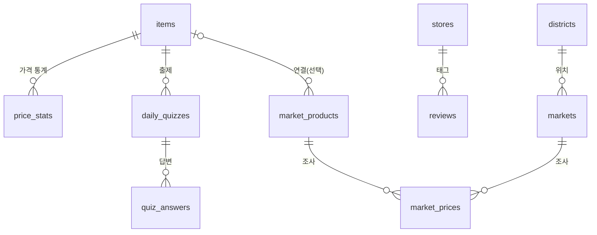

# WonSense DB 설계

> Supabase (PostgreSQL). 스키마 원본은 `supabase/migrations/`

| 마이그레이션 | 내용 |
| --- | --- |
| `20261031162626_init_schema.sql` | 품목·가격 통계·퀴즈·가게·리뷰 (F1, F2, F4) |
| `20261031164254_seoul_market_prices.sql` | 자치구·시장·상품·가격 조사, 히트맵 뷰 (F3) |

---

## 1. 전체 구조

기능별로 쓰는 테이블:

| 기능 | 테이블 / 뷰 |
| --- | --- |
| F1 물가 검색 | `items`, `price_stats` |
| F2 오늘의 퀴즈 | `items`, `daily_quizzes`, `quiz_answers` |
| F3 히트맵 | `districts`, `markets`, `market_products`, `market_prices`, `district_price_index` 외 뷰 2개 |
| F4 리뷰 게시판 | `stores`, `reviews` |

---

## 2. 테이블

### 2.1 F1·F2: 품목과 퀴즈

**`items`**: 검색·퀴즈 대상 품목

| 컬럼 | 타입 | 설명 |
| --- | --- | --- |
| id | bigint PK | |
| name_en / name_ko | text | 품목명 |
| aliases | text[] | 동의어 (`soju`, `소주` …). GIN 인덱스 |
| category | text | food / drink / goods / transport … |
| unit | text | per serving, per bottle … |
| quiz_enabled | boolean | 퀴즈 출제 대상 여부 |
| quiz_tolerance_correct / quiz_tolerance_close | numeric | 채점 허용 오차 (기본 0.10 / 0.25) |
| description_en | text | 학습 카드 설명 |

**`price_stats`**: 품목별 가격 통계 (참가격 외식비, 웹 검색 추정치 등)

| 컬럼 | 타입 | 설명 |
| --- | --- | --- |
| item_id | FK → items | |
| region | text | `'seoul'` 또는 자치구 코드 |
| price_min / price_avg / price_max | integer | 원 단위 |
| source | text | 출처 |
| reference_date | date | 기준 시점 |

**`daily_quizzes`**: 날짜(PK)별 문제, 품목, 정답가, LLM 해설
**`quiz_answers`**: 익명 답변 통계 (추정가, 판정 결과)

### 2.2 F4: 리뷰

**`stores`**: 리뷰에 태그되는 가게 (이름, 카테고리, 자치구, 주소)

**`reviews`**

| 컬럼 | 타입 | 설명 |
| --- | --- | --- |
| store_id | FK → stores | |
| nickname | text | 기본 `Anonymous` |
| password_hash | text | bcrypt 해시. **API 응답에 절대 포함 금지** |
| title / body | text | 검색용 trigram 인덱스 |
| paid_price | integer | 실제 지불 가격 (선택) |
| price_feeling | text | cheap / fair / expensive |
| rating | smallint | 1~5 |
| updated_at | timestamptz | 수정 시 트리거로 자동 갱신 |

### 2.3 F3: 서울시 생필품 가격 (히트맵)

출처: 서울 열린데이터광장 `ListNecessariesPricesService`. API 필드와 1:1로 대응시켰다.

**`districts`**: 서울 25개 자치구 (마이그레이션에서 미리 채워둠)

| 컬럼 | 설명 |
| --- | --- |
| code (PK) | 행정표준 시군구 코드 5자리 (예: `11680` 강남구). 지도 GeoJSON의 `SIG_CD`와 같은 체계 |
| name_ko / name_en | `강남구` / `Gangnam-gu` |

**`markets`**: 조사 대상 시장/마트

| 컬럼 | API 필드 | 설명 |
| --- | --- | --- |
| id (PK) | `M_SEQ` | |
| name | `M_NAME` | |
| type_code / type_name | `M_TYPE_CODE` / `M_TYPE_NAME` | 001 전통시장 / 002 대형마트 |
| district_code | `M_GU_NAME` → districts | 아래 수집 규칙 참고 |

**`market_products`**: 조사 상품 (규격 단위)

| 컬럼 | API 필드 | 설명 |
| --- | --- | --- |
| id (PK) | `A_SEQ` | |
| name | `A_NAME` | 예) `쌀(이천쌀) 10kg 1포` |
| category_code / category_name | `PRDLST_CD` / `PRDLST_NM` | 예) `A0001` / `쌀` |
| unit / quantity | `UNIT` / `QY` | 예) `10kg` / `1포` |
| item_id | — | F1/F2 `items`와 연결 (선택). 예) `소주 360ml` → 소주 |

**`market_prices`**: 가격 조사 결과

| 컬럼 | API 필드 | 설명 |
| --- | --- | --- |
| id (PK) | `P_SEQ` | 중복 제거 기준 |
| market_id / product_id | `M_SEQ` / `A_SEQ` | |
| price | `A_PRICE` | 원 단위 정수 |
| brand | `SPCIES` | 예) `(임금님표) 이천쌀` |
| note | `ADD_COL` | 할인 / 행사가 / 세일 … (없으면 null) |
| year_month | `P_YEAR_MONTH` | 해당 월 1일로 저장 (`2026-10-01`) |
| surveyed_on | `P_DATE` | 조사일 |

---

## 3. 히트맵 뷰

| 뷰 | 단위 | 내용 |
| --- | --- | --- |
| `district_product_prices` | 월 × 자치구 × 상품 | 구별 평균가, 표본 수 |
| `seoul_product_prices` | 월 × 상품 | 서울 평균가, 표본 수 |
| `district_price_index` | 월 × 자치구 | **물가 지수 (서울 평균 = 100)**, 비교한 상품 수 |

- 세 뷰 모두 **할인·행사 가격(`note`가 있는 행)은 제외**한다. 정상가 기준으로 비교하기 위해서다.
- 지수 계산: 자치구에서 조사된 상품마다 `구 평균가 / 서울 평균가`를 구해 평균낸 뒤 ×100.
  - 품목마다 가격 수준이 크게 다르기 때문에 금액을 그대로 평균내지 않고 비율로 바꿔 비교한다.
- 품목별 히트맵은 `district_product_prices`를 `market_products.category_code` 또는 `product_id`로 걸러서 쓴다.

**2026년 10월 실데이터 검증 결과** (API 7,070건, 시장 122곳, 상품 115개)

| 높은 구 | 지수 | 낮은 구 | 지수 |
| --- | --- | --- | --- |
| 강남구 | 105.9 | 금천구 | 95.0 |
| 동대문구 | 105.0 | 도봉구 | 95.8 |
| 중구 | 104.2 | 관악구 | 95.8 |

25개 구 모두 매핑되었고, 구별 비교 상품 수는 54~108개였다 (노원구가 54개로 가장 적음).

---

## 4. 수집 규칙 (서울시 API → DB)

API를 직접 호출해 확인한 특성과 그에 따른 규칙:

| 확인한 특성 | 규칙 |
| --- | --- |
| 페이지를 넘기면 **같은 `P_SEQ` 행이 다른 페이지에 또 나온다** (20,000건 중 2,489건 중복) | `market_prices`는 `id`(P_SEQ) 기준 **upsert**. 중복 삽입하지 않는다 |
| 같은 시장·상품을 한 달에 여러 번 조사한다 | 월 평균은 뷰에서 계산. 시장+상품+월에 유니크 제약을 두지 않는다 |
| `M_GU_CODE`가 `110000`과 `11110`처럼 두 형식으로 섞여 있다 | **`M_GU_NAME`(구 이름)으로 `districts.code`를 찾는다** |
| `A_SEQ` ↔ `A_NAME`, `M_SEQ` ↔ 자치구는 항상 1:1 | 상품·시장은 API ID를 그대로 PK로 쓴다 |
| 쌀 10kg / 4kg처럼 같은 품목에 규격이 여러 개 | 평균은 `product_id`(규격 단위)로 낸다 |
| `A_UNIT`은 항상 비어 있고 `A_PRICE`는 항상 숫자 | `A_UNIT`은 저장하지 않는다 |
| 한 번에 최대 1,000건 조회 | 페이지 단위로 반복 호출 |

수집 순서: `markets` upsert → `market_products` upsert → `market_prices` upsert

---

## 5. 접근 권한 (RLS)

- **모든 테이블에 RLS를 켜고 정책은 두지 않았다.** `anon` 키로는 아무것도 읽거나 쓸 수 없다.
- FastAPI 백엔드만 `service_role` 키로 접근한다. 프론트엔드는 항상 백엔드 API를 거친다.
- 뷰는 `security_invoker = true`로 만들어서, 뷰를 통해서도 RLS를 우회할 수 없게 했다.
- 나중에 프론트가 Supabase에 직접 접근해야 하면(예: Storage 업로드), 필요한 테이블·버킷에만 정책을 추가한다.
