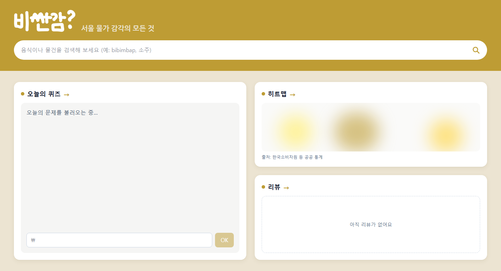

# WonSense 디자인 가이드

> FE 작업 시 따라야 할 디자인 기준. 각자 작업 중인 화면이 있다면 이 문서에 맞춰 수정해 주세요.

| 항목 | 내용 |
| --- | --- |
| 문서 버전 | v0.1 (초안) |
| 작성일 | 2026-11-01 |
| 기준 코드 | `feature/frontend` 브랜치의 `frontend/` |



---

## 0. 원칙 세 가지

1. **색·그림자는 토큰 클래스로만 쓴다.** `#BE9C34` 같은 hex 값을 컴포넌트에 직접 쓰지 않는다. 값은 [`globals.css`](../frontend/src/app/globals.css) 한 곳에만 있다.
2. **화면 문구는 [`strings.ts`](../frontend/src/lib/strings.ts)를 거친다.** 영어 버전(로드맵 1단계)을 위해 문자열을 하드코딩하지 않는다.
3. **있는 컴포넌트를 먼저 쓴다.** 섹션 제목, 검색창, 아이콘 등은 아래 [5. 컴포넌트](#5-컴포넌트)를 확인하고 새로 만들지 않는다.

---

## 1. 색

### 1.1 브랜드 토큰

[`globals.css`](../frontend/src/app/globals.css)의 `@theme`에 정의되어 있다. Tailwind 클래스로 쓴다 (`bg-brand`, `text-brand-pale`, `outline-brand` …).

| 토큰 | 값 | 쓰는 곳 |
| --- | --- | --- |
| `brand` | `#F2A81D` (호박색) | **채움 전용**: 주요 버튼, 검색 버튼, 퀴즈 태그, 그래프 선, 로고 색. 위 글씨는 `text-slate-900` (흰 글씨 금지: 대비 부족) |
| `brand-ink` | `#9A5A00` (진한 호박색) | **흰 바탕 위 글씨·링크·아이콘** (`text-brand-ink`). 흰 바탕 대비 4.5:1 이상 |
| `brand-pale` | `#FBF6EC` (크림색) | 페이지 배경, 상단부 배경, 카드 안쪽 박스, hover 하이라이트 |
| `brand-soft` | `#FDECC8` (연한 호박색) | 칩·태그 바탕, 카드 제목 아이콘 원, 스캔 버튼 바탕 |

- `text-brand`는 쓰지 않는다 (밝은 호박색이라 흰 바탕에서 안 읽힌다). 글씨는 항상 `text-brand-ink`.

### 1.2 보조 색 (Tailwind 기본 팔레트)

| 클래스 | 쓰는 곳 |
| --- | --- |
| `bg-white` | 카드, 검색창 |
| `bg-brand-pale` | 카드 안쪽 박스 (예: 퀴즈 문제 영역, 히트맵 범례) |
| `bg-stone-50` | 히트맵 미리보기 바탕 |
| `text-slate-900` | 기본 글씨 (body에 이미 적용) |
| `text-slate-500` / `text-slate-600` | 보조 글씨, 출처, 빈 상태 문구 |

### 1.3 쓰지 않는 색

- **보라·남색·분홍 계열** (`indigo`, `violet`, `purple`, `pink` …): create-next-app 초기 코드에서 남은 색. 보이면 `brand`로 바꾼다.
- **예외 — 의미를 가진 색**: 히트맵 색 스케일(저렴=파랑, 비쌈=빨강, `src/lib/heatmap.ts`), 퀴즈 정답/오답(초록/빨강), 오류 문구(`rose`)는 데이터·상태를 나타내므로 브랜드 색으로 바꾸지 않는다.
- 강조색이 더 필요하면 노란 계열(`yellow`, `amber`)에서 고르고, 새 토큰이 필요하면 `globals.css`에 추가한 뒤 이 문서에 적는다.

---

## 2. 글꼴

| 대상 | 글꼴 | 설정 위치 |
| --- | --- | --- |
| 기본 (전체) | 시스템 한글 폰트 (`system-ui`, Apple SD Gothic Neo, 맑은 고딕, Noto Sans KR 순) | `globals.css`의 `--font-sans` |
| 상단부 태그라인 | 나눔고딕 Bold (700) | `HomeHero.tsx`에서 `next/font/google`으로 로드 |

| 용도 | 클래스 |
| --- | --- |
| 섹션 제목 | `text-lg font-semibold` |
| 상세 페이지 제목 | `text-2xl font-bold` |
| 본문 | `text-base` |
| 출처·캡션 | `text-xs text-slate-500` |

---

## 3. 레이아웃

### 3.1 페이지 프레임

상단부와 본문이 같은 좌우 규칙을 써서 왼쪽 끝이 맞는다. 클래스는 [`src/lib/ui.ts`](../frontend/src/lib/ui.ts)에서 가져다 쓴다.

```tsx
import { card, frame } from "@/lib/ui";
// frame = "mx-auto w-full max-w-[1600px] px-4 md:px-10"
```

| 항목 | 모바일 | 데스크톱 (`md` 이상) |
| --- | --- | --- |
| 좌우 여백 | 16px (`px-4`) | 40px (`md:px-10`) |
| 최대 폭 | — | 1600px |
| 카드 사이 간격 | 24px (`gap-6`) | 24px |
| 본문 상하 여백 | 24px (`py-6`) | 32px (`md:py-8`) |

- **모바일 우선.** 기본 스타일은 폰 기준으로 쓰고, 넓은 화면은 `md:`로 덧붙인다.
- 홈 화면은 데스크톱에서 카드 영역이 남은 화면 높이를 꽉 채운다 (노트북 크롬 1440×780에서 스크롤 없이 한 화면).

### 3.2 상단부 (`HomeHero`)

홈 맨 위. 서울 스카이라인 배경 그림 위에, 왼쪽에 로고와 그 밑 호랑이, 오른쪽에 태그라인과 검색창 + 바가지 확인 버튼.

| 항목 | 값 |
| --- | --- |
| 배경 | `public/hero-bg.webp` (해·구름·남산타워 스카이라인, 2000×711), `bg-cover bg-bottom`, 그림이 없을 때 `bg-brand-pale` |
| 왼쪽 | `Logo`(높이 48px / 데스크톱 64px) 밑에 `public/mascot/horangi-3d-search.webp`(돋보기 든 호랑이, 높이 128px / 넓은 화면 160px). **640px 미만에서는 호랑이를 숨긴다** |
| 오른쪽 | 태그라인(나눔고딕 Bold, `text-slate-600`, 16px / 데스크톱 20px) 아래에 `SearchBar` + 오른편 바가지 확인 버튼(`/scan`, `bg-brand-soft` 알약, 높이 56px). 640px 미만에서는 버튼이 검색창 아래로 내려간다 |
| 로고 | `Logo` 컴포넌트. `logo_hand_white.png`를 CSS mask로 따서 `brand` 색으로 칠한다 |

### 3.3 상세 페이지 (`/search`, `/quiz`, `/heatmap`, `/reviews/...`)

모든 상세 페이지는 **`PageShell`로 감싼다.** 직접 `<main>`이나 "← 홈" 링크를 만들지 않는다.

```tsx
<PageShell title={t.review.pageTitle} description={t.review.pageDesc} action={<글쓰기 버튼 />}>
  {/* 페이지 내용 */}
</PageShell>
```

구성 (위에서부터):

1. **상단 바 (`SiteHeader`)** — 홈 상단부의 축소판. 크림색 띠 + 호박색 로고(높이 36px / 데스크톱 40px)만 있다. 검색창은 넣지 않는다. 로고를 누르면 홈으로 간다.
2. **제목 블록** — `text-2xl font-bold` 제목(앞에 점 없음), 아래에 `text-sm text-slate-600` 설명. 오른쪽에 주요 버튼 1개(`action`)를 둘 수 있다.
3. **본문** — 위아래 여백 32px / 데스크톱 40px.

- **좌우 여백은 홈과 같다.** 상단 바와 본문 모두 `frame`(16px / 데스크톱 40px, 최대 1600px)을 써서 로고·제목·카드의 왼쪽 끝이 홈과 일치한다. 페이지별로 폭을 따로 좁히지 않는다.
- 리뷰 상세·작성처럼 한 단계 아래 페이지는 `back`에 "← 목록으로" 링크를 넣는다.
- 본문 내용은 [4. 카드](#4-카드) 규칙대로 흰 카드에 담는다.

---

## 4. 카드

```tsx
import { card } from "@/lib/ui";
// card = "flex flex-col rounded-3xl bg-white p-5 shadow-card md:p-6"
```

| 항목 | 값 |
| --- | --- |
| 배경 | 흰색 |
| 모서리 | `rounded-3xl` (24px) |
| 안쪽 여백 | 20px (`p-5`) / 데스크톱 24px (`md:p-6`) |
| 그림자 | `shadow-card` — 금색을 어둡게 한 갈색 계열의 은은한 그림자 |
| 테두리 | 없음 |

- 카드 안쪽에 영역을 나눌 때는 `rounded-2xl bg-brand-pale p-4` 박스를 쓴다.
- 카드 제목은 `SectionHeader`를 쓴다. `icon`(SectionIcons의 아이콘, `bg-brand-soft` 원 안에 들어감)과 `actionLabel`(오른쪽 "자세히 보기" 알약 링크)을 줄 수 있다.
- 홈 카드는 2×2: 퀴즈 | 히트맵 / 환율 | 리뷰.

### 4.1 마스코트 (호랑이)

원본 포즈는 리포 루트 `mascot/`에 있다. 화면에 쓰는 것만 `frontend/public/mascot/`에 복사한다.

| 위치 | 포즈 |
| --- | --- |
| 홈 상단부 | `horangi-3d-search.webp` (돋보기) |
| 홈 퀴즈 카드 오른쪽 (넓은 화면만) | `horangi-3d-hold-lightbulb.webp` (전구) |

- 장식이라 `alt=""`. 한 화면에 한두 마리만 둔다.
- 회색(`shadow-sm`, `shadow-md` 등) 그림자나 `border`로 입체감을 주지 않는다.
- **예외 — 떠 있는 요소**: 툴팁, 드롭다운 목록처럼 다른 요소 위에 겹쳐 뜨는 것은 `border border-slate-200 shadow-lg`를 쓴다.
- 리뷰 카드처럼 눌러서 이동하는 카드의 hover는 `hover:ring-1 hover:ring-brand/50`.

---

## 5. 컴포넌트

| 컴포넌트 | 위치 | 용도 |
| --- | --- | --- |
| `PageShell` | `src/components/PageShell.tsx` | 상세 페이지 공통 틀. 상단 바 + 제목 블록 + 본문 ([3.3](#33-상세-페이지-search-quiz-heatmap-reviews)) |
| `SiteHeader` | `src/components/SiteHeader.tsx` | 상세 페이지 상단 바. 로고(홈 링크)만. 보통은 `PageShell`이 넣어준다 |
| `SectionHeader` | `src/components/SectionHeader.tsx` | 홈 카드 제목. 금색 점 + 제목 + 금색 `→`, 통째로 링크 |
| `SearchBar` | `src/components/SearchBar.tsx` | 흰색 알약 모양 검색창 (`rounded-full`), 테두리·그림자·포커스 외곽선 없음 |
| `SearchIcon` | `src/components/icons/SearchIcon.tsx` | flat 돋보기 SVG. 색은 `text-*` 클래스로 지정 (`currentColor`) |
| `ErrorBox` | `src/components/ErrorBox.tsx` | 불러오기 실패 안내. 제목 + 서버 메시지, 필요하면 `children`에 다시 시도 버튼 |

### 아이콘

- 이모지 대신 **선으로 그린 단색 SVG**를 쓴다 (`stroke="currentColor"`, 굵기 2.5, 둥근 끝).
- 새 아이콘은 `src/components/icons/`에 `SearchIcon`과 같은 형태로 추가한다.

### 버튼·링크

- 주요 버튼: `rounded-lg bg-brand px-4 py-2 font-medium text-white` (hover는 `hover:bg-brand/90`)
- 보조 버튼: `rounded-lg border border-brand px-4 py-2 font-medium text-brand`
- 선택된 칩/토글: `border-brand bg-brand text-white`
- 텍스트 링크: `text-brand`
- 입력칸: `src/lib/ui.ts`의 `inputClass` (포커스하면 `focus:border-brand`)

---

## 6. 문구

- 모든 화면 문구는 [`strings.ts`](../frontend/src/lib/strings.ts)의 `strings.ko`에 추가하고 `t.키이름`으로 쓴다.
- 섹션 이름은 한국어로 통일: **물가 퀴즈 · 서울 물가 히트맵 · 외국인 찐 리뷰 · 물가 검색**. 홈 카드 제목과 상세 페이지 제목은 같은 키를 쓴다 (`t.heatmapPageTitle`, `t.review.pageTitle` 등).
- "← 홈" 링크는 만들지 않는다. 홈으로 가는 길은 상단 바의 로고 하나로 통일한다.

---

## 7. 아직 정하지 않은 것

정해지면 이 문서를 업데이트한다. 그 전까지는 현재 코드 상태를 따른다.

1. 입력칸·리뷰 빈 상태의 회색 테두리(`slate-300`)를 따뜻한 회색/금색 계열로 바꿀지
2. 금색 배경 위 흰 글씨·베이지 글씨의 대비가 웹 접근성 권장치(4.5:1)보다 낮은 문제를 어떻게 할지

---

## 8. 체크리스트 (PR 올리기 전)

- [ ] 컴포넌트에 hex 색을 직접 쓰지 않았다
- [ ] 보라·남색·분홍 계열 클래스가 없다
- [ ] 카드는 `shadow-card`를 쓰고 `border`/회색 그림자가 없다
- [ ] 화면 문구는 `strings.ts`를 거친다
- [ ] 홈 카드 제목은 `SectionHeader`를 쓴다
- [ ] 새 상세 페이지는 `PageShell`로 감쌌다 ("← 홈" 링크·직접 만든 `<main>` 없음)
- [ ] 폰 폭(390px 안팎)에서 가로 스크롤 없이 보인다
